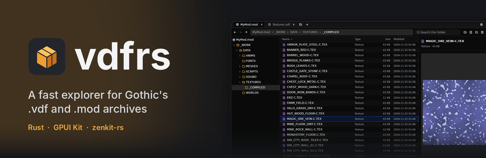
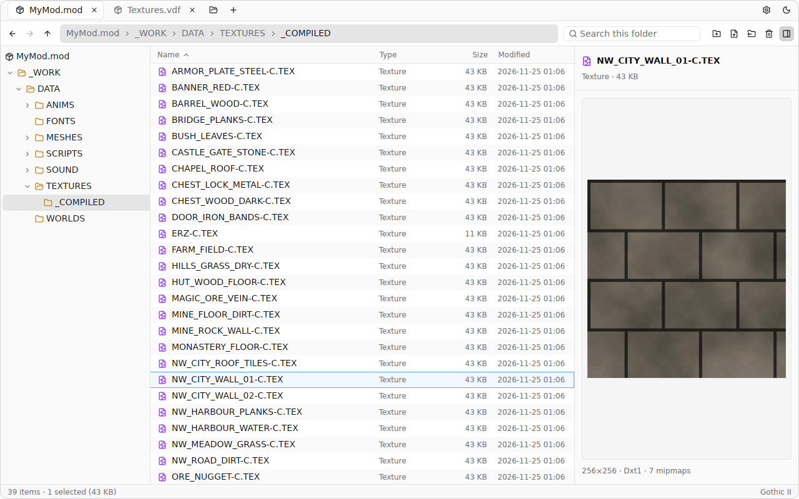
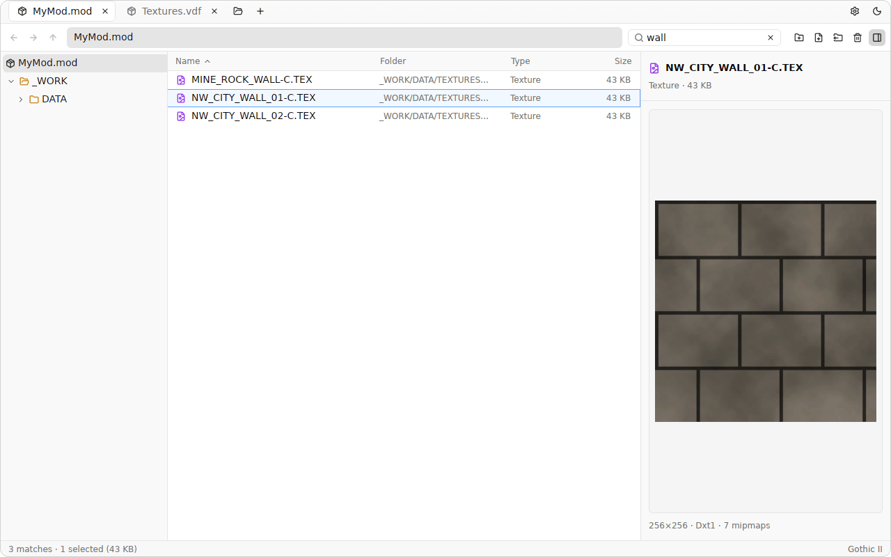
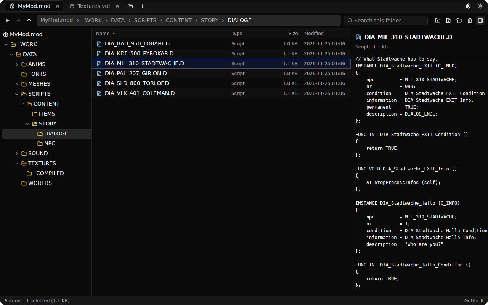
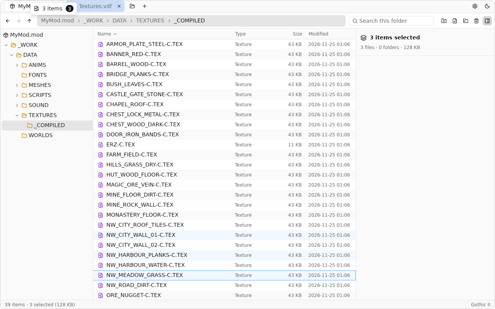
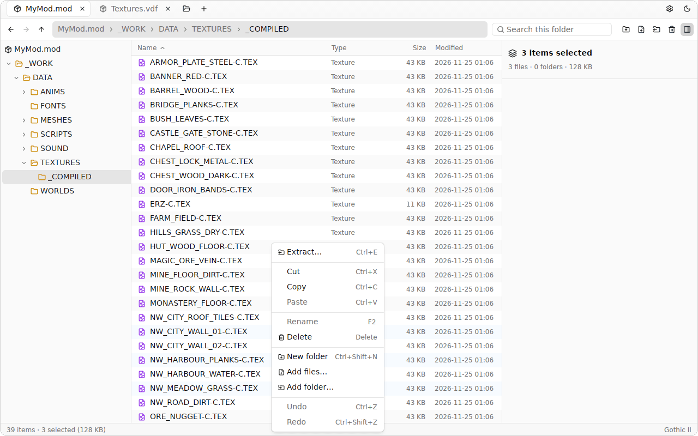
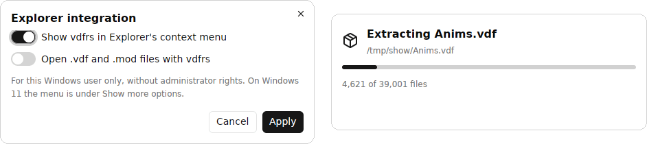

<p align="center">
  
</p>

# vdfrs

A file explorer for the ZenGin's `.vdf` and `.mod` archives, built on
[zenkit-rs](https://github.com/Zira3l137/zenkit-rs) and [GPUI Kit](https://gpui-kit.com). Open an
archive and work in it as in a folder: browse, search, preview, drag files in and out, rename,
delete, and save it back as the game reads it.

vdfrs was made by Zira3l137 with the assistance of Claude (Claude Opus 5.5), Anthropic's AI model.
It began as a test of zenkit-rs in a real application, which also turned up the two additions to
its VFS released in zenkit-rs 0.1.1.

<picture>
  <source media="(prefers-color-scheme: dark)" srcset="docs/screenshots/dark.png">
  
</picture>

Windows and Linux builds of every release are on the
[releases page](https://github.com/Zira3l137/vdfrs/releases). To build it yourself:

```sh
cargo run --release -- Data/Anims.vdf Data/ModVDF/MyMod.mod
```

It needs a recent stable Rust, and on Linux the packages GPUI builds against
(`libxkbcommon-dev`, `libwayland-dev`, `libxcb1-dev`, `libvulkan-dev`, `libfontconfig-dev`).

## What it does

- **Tabs.** Each archive opens in a tab of its own, at once however large it is: only its catalog
  is read, and each file the first time you open it. Drop `.vdf` or `.mod` files on the window to
  open them; drop anything else on the start page to pack it into a new archive.
- **Browsing.** A folder tree, a list that draws only the rows on screen, a breadcrumb bar whose
  parts are drop targets too, back, forward and up. The list sorts by name, type, size or date,
  folders first.
- **Search.** Searches the folder and everything below it as you type: part of a name, or a
  pattern like `*-C.TEX`. Stops at 20,000 matches.
- **Preview.** Textures (`.TEX`) as pictures, decoded by the library, with their size, format and
  mipmaps; scripts, model scripts and other text as text; anything else as a hex dump. Selecting a
  folder shows what is in it; selecting nothing shows the archive's header and totals.
- **Drag and drop.**
  - Rows onto folders, the tree or the breadcrumbs move them; hold Ctrl (Cmd) or Alt to copy.
  - Rows onto another archive's tab copy them into the folder open there.
  - Files and folders from the system are added where they are dropped.
  - Rows dragged out of the window become files wherever they are dropped: the explorer extracts
    them to a temporary folder as the pointer leaves the window (up to 512 MB at once).
- **Editing.** New folders, inline rename, delete, cut, copy and paste between any archives, and
  undo and redo for all of them.
- **Saving.** Writes the archive back with the header it had: the game's signature, the comment,
  and Union's compression. Archive settings change those. A save goes to a file beside the
  archive that then takes its place, so a failed save leaves the old archive whole.
- **Extracting** the selection or the whole archive to a folder, in parallel.
- Opening any file in the program the system has for it, from a temporary copy.
- Light and dark themes.

<table>
  <tr>
    <td width="50%"></td>
    <td width="50%"></td>
  </tr>
  <tr>
    <td align="center"><sub>Search a whole archive as you type</sub></td>
    <td align="center"><sub>Read scripts and other text right in the preview</sub></td>
  </tr>
  <tr>
    <td width="50%"></td>
    <td width="50%"></td>
  </tr>
  <tr>
    <td align="center"><sub>Drag entries into other folders and other archives</sub></td>
    <td align="center"><sub>Everything a right click away, with its shortcut</sub></td>
  </tr>
</table>

## In Windows Explorer

Like 7-Zip, vdfrs can put a **vdfrs** submenu in Explorer's context menu. Turn it on with the
folder button in vdfrs's title bar, or from a terminal:

```sh
vdfrs shell install              # the menu
vdfrs shell install --associate  # the menu, and .vdf and .mod files open in vdfrs on a double click
vdfrs shell uninstall            # takes all of it out again
vdfrs shell status
```

<p align="center">
  
</p>

| Right-click on…     | The vdfrs submenu has                                                     |
|---------------------|---------------------------------------------------------------------------|
| `.vdf` and `.mod`   | Open, Extract files…, Extract here, Extract to own folder, Add to new archive… |
| Files and folders   | Add to new archive…, Pack into .vdf                                       |

Each works on everything selected: opening several archives opens them as tabs of one window,
extracting several does each one, and packing several files makes one archive, named after the
folder they are in. Extracting and packing show a small progress window that closes when it is
done, or says what went wrong.

The integration is a set of registry keys under `HKEY_CURRENT_USER\Software\Classes`, for your user
only, so it needs no administrator rights. It points to the `vdfrs.exe` it was turned on from: move
the program, and turn it on again from the new place. On Windows 11 the menu is under
**Show more options**.

## On the command line

The commands the menu runs work from a terminal too, printing what they did instead of showing a
window, so they also work without a desktop, over SSH or in a script:

```sh
vdfrs extract Anims.vdf Textures.vdf          # each into a folder named after it
vdfrs extract --here Anims.vdf                # into the folder it is in
vdfrs extract --to D:/Out Anims.vdf
vdfrs pack _work/Data --out MyMod.vdf         # without --out, beside the first item
vdfrs new _work                               # a new archive in the explorer, unsaved
```

## Keys

| Keys                                | Does                                    |
|-------------------------------------|-----------------------------------------|
| Ctrl+O / Ctrl+N / Ctrl+W            | Open, new archive, close tab            |
| Ctrl+Tab / Ctrl+Shift+Tab           | Next and previous tab                   |
| Ctrl+S / Ctrl+Shift+S               | Save, save as                           |
| Ctrl+F                              | Search                                  |
| Enter / Backspace                   | Open the selection / go up              |
| Alt+Left / Alt+Right / Alt+Up       | Back, forward, up                       |
| Arrows, Home, End, Page Up/Down     | Move the selection; with Shift, extend  |
| Ctrl+A                              | Select all                              |
| F2 / Delete                         | Rename, delete                          |
| Ctrl+X / Ctrl+C / Ctrl+V            | Cut, copy, paste                        |
| Ctrl+Z / Ctrl+Y                     | Undo, redo                              |
| Ctrl+Shift+N                        | New folder                              |
| Ctrl+E / Ctrl+Shift+E               | Extract the selection, extract all      |
| Alt+P                               | Show or hide the preview                |
| Esc                                 | Cancel a rename, clear the search, then the selection |

On macOS, Cmd takes the place of Ctrl.

## What the format allows

A VDF stores names in upper case, in Latin-1, at most 64 characters, and cannot store a folder
with no files in it. The explorer refuses names it could not save, and says how many empty folders
a save left out.

## Limits

- Dragging out of the window works on Windows and on Linux under Wayland. GPUI has no outbound
  drag on X11, so there, use Extract.
- The file dialogs on Linux go through the desktop portal (`xdg-desktop-portal`).
- Opening an archive from Explorer starts a new window rather than a tab in an open one.
- An open archive stays open, since its files are read as you open them. On Windows, saving it over
  itself needs an NTFS drive; on a FAT32 or exFAT one, save it under another name.
